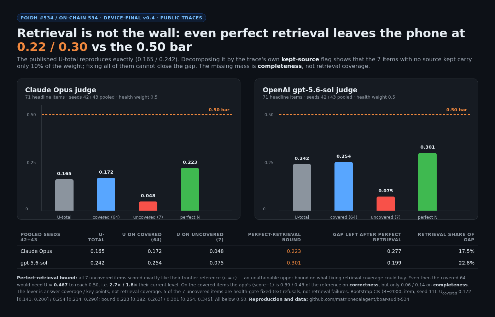

# POIDH #534 — Retrieval is not the wall

**Audit of “Audit a Month of Offline AI Research” (RatLab / Boar), record 1.1.2, DEVICE-FINAL v0.4.**
Public data only. No model runs, no private files. Reproduction: [`analysis.py`](analysis.py).
Screenshot: [`chart.png`](chart.png).

---

## One-paragraph finding

The published phone U-total reproduces exactly: **0.1645 (Claude Opus)** and **0.2424 (gpt-5.6-sol)**, seeds 42+43 pooled, 71 headline items, health weight 0.5. The record's own trace flag `ruler.kept` (the variable behind “coverage 0.90”) partitions the 71 items into **64 covered** items and **7 uncovered** items. U on the covered items is **0.1722 / 0.2538**; U on the uncovered items is **0.0477 / 0.0745**. Now the decisive counterfactual: give all 7 uncovered items the score of **their frontier reference** (`u = r`) — an unattainable upper bound on what fixing retrieval coverage could buy. U-total rises only to **0.2234 / 0.3012**, still **0.28 / 0.20 below the 0.50 bar**. **At least 77% of the gap is not retrieval coverage.** On the covered items the app reaches **0.39 / 0.43** of the reference on *correctness*, but only **0.06 / 0.14** on *completeness*. The binding constraint is the number of the reference's key points the answer covers, not whether any source was kept. This is also the spec's missing `U-ref` / `U-noref` row (`RULER-SPEC-v1-r4`, §2 line 21, §3.4 line 101, and the “never print” list line 244), and it directly bounds the “retrieval is the wall” reading of claims 3935 / 4033.



---

## 1. What was checked, and what reproduces

I loaded the public artifacts:

| Input | Path |
|---|---|
| 71 headline items, weights, anchors | `boar-research/rnd/research/coordinator/arms/native-rc/work/v04/bench/questions.jsonl` |
| Phone traces, seeds 42 / 43 | `boar-traces/.../device-final/traces/dev-s4{2,3}.traces.jsonl` |
| Judgments, both orders, both families | `boar-traces/.../device-final/judge/dev-s4{2,3}.{opus,codex}.judgments.jsonl` |
| References | `boar-bench/bench/v0.4/refs/v2/{claude,codex}.jsonl` |

The aggregation rule is the record's own: both presentation orders required; refusal (`refusedZ`) counted as `u = 0`; `u = mean(correctness, completeness, usefulness) − 1`; `r = mean(ref scores) − 1`; U = Σ w·u / Σ w·r; w = 0.5 for the 11 health items, 1 otherwise; 71 items with `anchor = false`.

**The published numbers reproduce to four decimals** (seed 42 shown; 43 and the pooled values are in the table):

| | published | recomputed |
|---|---:|---:|
| Claude Opus, s42 | 0.1668 | **0.1668** |
| gpt-5.6-sol, s42 | 0.2440 | **0.2440** |
| Claude pooled 42+43 | 0.1645 | **0.1645** |
| gpt-5.6-sol pooled | 0.2424 | **0.2424** |

So the arithmetic layer is sound. The finding is about what the headline does *not* decompose.

---

## 2. The missing decomposition

`RULER-SPEC-v1-r4` requires the headline to be published **with** `U-ref` (covered items, `C_X`), `U-noref` (uncovered items, `N_X`), and the show-anyway sensitivity. The report publishes `coverage = 0.90` but not the pair. Using the trace's own `kept` flag as `C_X` / `N_X`:

| Family (pooled 42+43) | U-total | U covered (n=64) | U uncovered (n=7) | Perfect-retrieval bound | Gap left after perfect retrieval | Retrieval share of gap |
|---|---:|---:|---:|---:|---:|---:|
| Claude Opus | 0.1645 | **0.1722** | **0.0477** | **0.2234** | 0.2766 | 17.5% |
| gpt-5.6-sol | 0.2424 | **0.2538** | **0.0745** | **0.3012** | 0.1988 | 22.8% |

Bootstrap CIs (B = 2,000, item resample, seed 11):

- Opus: U-covered **0.1722 [0.141, 0.200]**; bound **0.2234 [0.182, 0.263]**.
- gpt-5.6-sol: U-covered **0.2538 [0.214, 0.290]**; bound **0.3012 [0.254, 0.345]**.

**Every interval is below 0.50.**

Definitions:

- **Covered** = `ruler.kept == true` on the item's trace (at least one retrieved source kept). This is the same variable behind the published “coverage 0.90” = 64/71.
- **Uncovered** = `ruler.kept == false`.
- **Perfect-retrieval bound** = `(Σ_C w·u + Σ_N w·r) / Σ_H w·r`: the 7 uncovered items are assumed to score exactly like their frontier reference. This is deliberately **more generous than any real fix**: it gives the app the reference's score on items where it currently has no source at all.

The bound says: even if the 7 uncovered items became *as good as the frontier reference*, the covered 64 would still need **U ≈ 0.467** to reach the bar — **2.7×** (Opus) / **1.8×** (gpt-5.6-sol) their current U-covered.

A second, more realistic bound gives the 7 uncovered items the **covered-item mean** instead of the reference: U-total becomes exactly U-covered (0.1722 / 0.2538), i.e. retrieval coverage buys **2.3% / 4.4%** of the gap. So the honest range for “fix retrieval coverage” is **~2–23% of the gap**, and the 23% end is unattainable.

---

## 3. Where the gap actually is

On the 64 covered items, split by judge dimension (app − 1) / (reference − 1):

| Family (covered items) | Correctness | Completeness | Usefulness |
|---|---:|---:|---:|
| Claude Opus | **0.387** (1.431 / 3.693) | **0.060** (0.236 / 3.947) | **0.084** (0.337 / 3.996) |
| gpt-5.6-sol | **0.425** (1.553 / 3.657) | **0.140** (0.524 / 3.744) | **0.203** (0.787 / 3.882) |

The app is relatively correct and radically incomplete. Its median answer is **37.5 words**; the references are **690 words** (Claude) and **421 words** (gpt-5.6-sol). No answer hit the 512-token cap (`capHit` is false on every headline item), so this is the **Succinct persona / answer policy**, not truncation. Length alone is not the lever — the rank correlation between app words and app completeness is weak (−0.03 Opus, +0.29 Codex) — the lever is **covering the question's key points**.

This is consistent with the record's own **LENGTHSHARE** experiment (X-108): shortening the *references* to ≤80 words moved the deep tier 0.412 → 0.514, with **≈83% of the remaining gap attributed to missing substance**, not length. The present result puts a number on the *retrieval* share of that substance gap on the actual ruler: at most ~23%, realistically ~2–5%.

---

## 4. Why this matters for the “retrieval is the wall” reading

Claims **3935** and **4033** conclude that retrieval is the binding constraint (65% correct when the article is delivered vs 26% without; delivery 54%; hybrid retrieval would lift the model to ~61%). That is a claim about the **M3 pack self-tests** and article-level delivery, not about the v0.4 ruler. On the ruler:

- The 7 uncovered items carry only **10% of the headline weight** (7 of 65.5).
- **5 of those 7 are the health gate's fixed-text refusals** (`cw-021`, `cw-022`, `cw-025`, `cx-021`, `cx-023`), not retrieval failures; only `cx-035` and `cx-036` are answered without a kept source.
- Even the unattainable perfect-retrieval bound leaves **0.223 / 0.301** vs 0.50.

So “retrieval is the wall” is **not supported on the ruler**, and the two results are not in conflict: the pack self-tests are easier, and their delivery split is a between-item conditional (see also claims **4157** and **4174**, which show the phone delivery split is a title-matcher artefact and that pack-level delivery does not predict accuracy). The ruler's missing mass is completeness — the number of key points the answer states — on items where a source *was* kept.

This also sharpens claim **4013** (“the 0.50 bar is a coverage bar”): the bar is coverage of the **reference's points**, not coverage of **retrieval**. The two are different, and the record's own numbers now separate them.

---

## 5. What I could not check, and what would change my mind

- **`kept` is “any source kept”, not “the right source kept”.** The phone traces carry source titles only; the spec's stricter *support coverage* (`S_X`, kept text contains the item's points) is “not measurable on this RC” by the record's own statement. A right-source split could be higher than U-covered. But the perfect-retrieval bound does not depend on that: it assumes the **7 no-source items become perfect**, and U still stays below 0.50.
- **5 of 7 uncovered items are deliberate health refusals.** The perfect-retrieval bound gives them the reference's score anyway, so it is generous; a safety-conscious app may prefer the zero. That makes the retrieval share smaller, not larger.
- **Two seeds, two judge families, one phone.** The CIs above are item bootstraps; they do not include seed or judge noise. The conclusion is robust because the upper bounds (0.263 / 0.345) are far from 0.50.
- **What would change my mind:** a re-run on v0.4 with the 7 no-source items forced to retrieve *and* a right-source/support-coverage label, showing U-covered ≥ 0.47. The cheap version: publish `U-ref` / `U-noref` and the dimension split for the existing traces (this script); the expensive version: a coverage-oriented answer policy, judged on the same 71 items, with the bar applied to the lower family.

---

## 6. Reproduction

```bash
# inputs (public): clone r4topunk/boar-research and r4topunk/boar-bench,
# download the device-final traces/judgments from r4topunk/boar-traces.
export BOAR_ROOT=/path/to/boar            # contains res/, bench/
python3 analysis.py
```

`analysis.py` uses only the Python standard library, reproduces the published U-total first, then prints the table above. `uc_un.json` is the raw output used for this page.

**Files**

- [`analysis.py`](analysis.py) — the decomposition, bound, CIs, dimension split.
- [`uc_un.json`](uc_un.json) — raw results.
- [`chart.html`](chart.html), [`chart.png`](chart.png) — the figure.

---

## 7. Bottom line

The record's negative headline is correct and its arithmetic is clean. But the report's own missing `U-ref` / `U-noref` decomposition shows that **retrieval coverage cannot be the lever**: the 7 uncovered items are 10% of the weight, and even making them as good as the frontier reference leaves the phone at **0.223 / 0.301** against a **0.50** bar. The app's correctness on covered items is already ~40% of the reference; its **completeness is 6–14%**. The next experiment should target **key-point coverage in the answer** (and, separately, right-source precision), not more retrieval coverage.

*Independent audit, public data only. No claim of access to private files or model re-runs. Numbers computed from the published traces and judgments; the script is included so they can be checked.*
